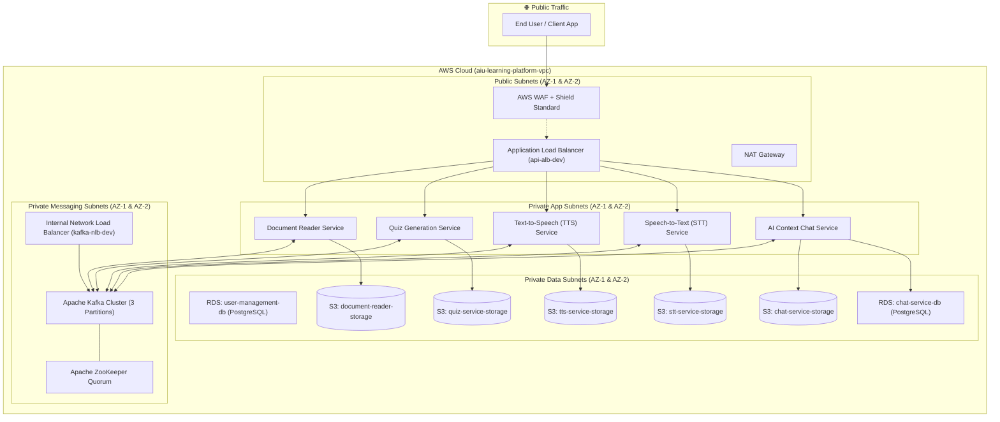
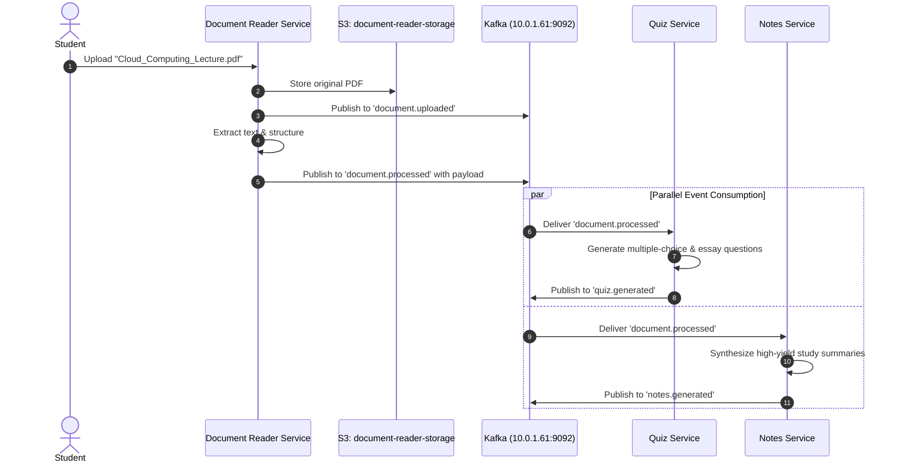

# Cloud-Based Learning Platform — AWS Enterprise Architecture

[](https://aws.amazon.com/)
[](https://www.docker.com/)
[](https://kafka.apache.org/)
[](https://aws.amazon.com/rds/)
[](https://aws.amazon.com/cloudformation/)
[](https://aws.amazon.com/codepipeline/)
[](https://aws.amazon.com/kms/)

---

## 📌 Executive Summary

The **Cloud-Based Learning Platform** is an enterprise-grade, distributed educational system engineered on **Amazon Web Services (AWS)**. Designed to address the demands of modern cloud computing and modular e-learning, this platform facilitates automated document parsing, lecture transcription, quiz synthesis, text-to-speech conversion, and interactive AI tutoring.

The architecture strictly adheres to cloud native engineering principles:
* **Microservices Autonomy:** Isolated services with independent lifecycles.
* **Complete Storage Isolation (Database-per-Service):** No cross-service database access or shared object storage.
* **Asynchronous Event-Driven Messaging:** Decoupled inter-service synchronization orchestrated via **Apache Kafka**.
* **Zero-Downtime Deployments:** Fully automated CI/CD pipelines executing **Blue-Green deployments** via Amazon ECS and Application Load Balancers.
* **Defense-in-Depth Security:** Multi-tier VPC isolation, KMS customer-managed keys, AWS WAF, IAM least-privilege policies, and Secrets Manager.

---

## 📑 Table of Contents

1. [System Architecture Overview](#-system-architecture-overview)
2. [VPC & Network Infrastructure](#-vpc--network-infrastructure)
3. [Microservices Breakdown](#-microservices-breakdown)
4. [Storage Isolation & Database Strategy](#-storage-isolation--database-strategy)
5. [Event-Driven Data Sharing via Apache Kafka](#-event-driven-data-sharing-via-apache-kafka)
6. [CI/CD & Blue-Green Deployment Pipeline](#-cicd--blue-green-deployment-pipeline)
7. [Security & Compliance Framework](#-security--compliance-framework)
8. [Serverless Utilities & Automation](#-serverless-utilities--automation)
9. [Detailed Event Flow Walkthroughs](#-detailed-event-flow-walkthroughs)
10. [Local Development & Cloud Deployment Guide](#-local-development--cloud-deployment-guide)
11. [Troubleshooting, Engineering Challenges & Solutions](#-troubleshooting-engineering-challenges--solutions)
12. [Project Documentation Reference](#-project-documentation-reference)

---

## 🏛 System Architecture Overview

The system transitions traditional monolithic coupling into an **Event-Driven Distributed Microservices Architecture**.



---

## 🌐 VPC & Network Infrastructure

The network architecture is established within a dedicated Virtual Private Cloud named **`aiu-learning-platform-vpc`** (`10.0.0.0/16`) spanning two Availability Zones (AZs) for high availability and fault resilience.

### Subnet Allocation Matrix

| Subnet Tier | CIDR Block (AZ-1) | CIDR Block (AZ-2) | Route Table Target | Hosted Workloads |
| :--- | :--- | :--- | :--- | :--- |
| **Public** | `10.0.1.0/24` | `10.0.2.0/24` | Internet Gateway (`igw`) | Application Load Balancer (`api-alb-dev`), NAT Gateway |
| **Private Backend** | `10.0.10.0/24` | `10.0.11.0/24` | NAT Gateway (`nat-gw`) | Container Hosts, ECS Microservice Tasks |
| **Messaging (Kafka)** | `10.0.30.0/24` | `10.0.31.0/24` | Internal Only / Local VPC | Kafka Brokers, ZooKeeper Coordination Nodes, Internal NLB |
| **Database / Data** | `10.0.20.0/24` | `10.0.21.0/24` | Internal Only / Local VPC | Amazon RDS Multi-AZ PostgreSQL Instances |

### Network Access Control Lists (NACLs)

#### Public Subnet NACL
* **Inbound:**
  * Rule 100: TCP 80 (`0.0.0.0/0`) &rarr; `ALLOW`
  * Rule 110: TCP 443 (`0.0.0.0/0`) &rarr; `ALLOW`
  * Rule 120: Ephemeral Ports 1024–65535 (`0.0.0.0/0`) &rarr; `ALLOW`
* **Outbound:**
  * Rule 100: ALL Traffic (`0.0.0.0/0`) &rarr; `ALLOW`

#### Private Application & Data Subnet NACL
* **Inbound:**
  * Rule 100: ALL Protocols from VPC CIDR (`10.0.0.0/16`) &rarr; `ALLOW`
* **Outbound:**
  * Rule 100: ALL Traffic (`0.0.0.0/0`) via NAT &rarr; `ALLOW`

### Security Group Ingress Hierarchy (Principle of Least Privilege)

1. **ALB Security Group (`alb-sg`):** Allows inbound port 80/443 from `0.0.0.0/0`.
2. **Microservices Security Group (`microservices-sg`):** Allows port 8080/8081/8082 only from `alb-sg`.
3. **Kafka Security Group (`kafka-sg`):** Allows port 9092 (Kafka) and 2181 (ZooKeeper) only from `microservices-sg`.
4. **Database Security Group (`rds-sg`):** Allows port 5432 (PostgreSQL) only from authorized backend microservices within `microservices-sg`.

---

## 🧩 Microservices Breakdown

| Service Name | Primary Responsibility | Input Format | Output Format | Storage Backend | Event Topics |
| :--- | :--- | :--- | :--- | :--- | :--- |
| **Document Reader** | Parses PDF/DOCX course materials, performs OCR/text extraction | Multipart PDF / Doc | Structured Text & Metadata | `document-reader-storage-dev-m` | `document.uploaded`<br>`document.processed` |
| **Quiz Generation** | Synthesizes multiple choice & open questions based on content | Extracted Text Payload | Structured Quiz Schemas (JSON) | `quiz-service-storage-dev-n` | `quiz.requested`<br>`quiz.generated` |
| **Text-to-Speech (TTS)** | Converts study notes and summaries into natural audio lectures | Plaintext / SSML | MP3 / WAV Audio Streams | `tts-service-storage-dev-m` | `audio.generation.requested`<br>`audio.generation.completed` |
| **Speech-to-Text (STT)** | Transcribes audio lectures into searchable, timestamped text | Audio Stream / MP3 | Transcribed Text & Confidence | `stt-service-storage-dev-r` | `audio.transcription.requested`<br>`audio.transcription.completed` |
| **Chat Service** | Context-aware AI assistant querying uploaded course knowledge | User Prompts | AI Contextual Answers | `chat-service-storage-dev-a`<br>`chat-service-db` | `chat.message` |
| **User Management** | Authentication, authorization, student profile state | JWT / Credentials | User Profile & Sessions | `user-management-db` | N/A |

---

## 🗄 Storage Isolation & Database Strategy

### The Storage Isolation Principle

In compliance with enterprise cloud architecture standards, **direct database queries and shared storage across service boundaries are strictly forbidden**:

```
❌ Traditional Coupled Pattern (AVOIDED):
Quiz Service ──── Direct SQL Query ────> [ Document Reader's DB ]
Quiz Service ──── Direct S3 Access ────> [ Document Reader's S3 Bucket ]
(Causes schema lock-in, shared downtime, cascading outages, and broad IAM exposure)

✅ Implemented Event-Driven Isolation:
Document Reader ── Publishes "document.processed" ──> [ Kafka Topic ]
                                                              │
                    ┌─────────────────────────────────────────┘
                    ▼
Quiz Service (Consumes event & stores transformed quiz in its own dedicated DB/S3)
```

### Dedicated Amazon RDS Deployments

* **Engine:** PostgreSQL 15+ (Engine: `postgres`)
* **Encryption:** At-rest encryption using **AWS KMS** Customer Master Keys (CMKs)
* **High Availability & Durability:** Automated multi-AZ snapshots with **7-day retention period**
* **Deployment Details:**
  1. `user-management-db`: `user-management-db.<unique-id>.us-east-1.rds.amazonaws.com`
  2. `chat-service-db`: `chat-service-db.<unique-id>.us-east-1.rds.amazonaws.com`
  3. *Next Phase Provisions:* `document-reader-db` and `quiz-service-db`

### Isolated Amazon S3 Buckets & Bucket Policies

Every microservice operates within an isolated Amazon S3 bucket protected with:
* **Server-Side Encryption:** `SSE-KMS`
* **Object Versioning:** Enabled across all buckets for instant rollback and auditability
* **Scoped IAM Policies:** Enforcing `s3:GetObject` and `s3:PutObject` strictly to each service's ARN path

```json
{
  "Version": "2012-10-17",
  "Statement": [
    {
      "Sid": "RestrictToDocumentReaderOnly",
      "Effect": "Allow",
      "Action": [
        "s3:GetObject",
        "s3:PutObject"
      ],
      "Resource": "arn:aws:s3:::document-reader-storage-dev-m/*"
    }
  ]
}
```

---

## ⚡ Event-Driven Data Sharing via Apache Kafka

### Broker & Topology Configuration
* **Bootstrap Server:** `10.0.1.61:9092`
* **Cluster Spec:** Distributed Kafka Broker on EC2 (`t3.medium`) backed by a dedicated ZooKeeper coordination node
* **Topic Configuration:** 3 Partitions per topic (enabling high-throughput parallel consumer groups), Replication Factor 1 (dev baseline)

### Service Communication Matrix

```
+---------------------+----------------------------------------------------+----------------------------------------------------+
| Service             | Produces To Topics                                 | Consumes From Topics                               |
+---------------------+----------------------------------------------------+----------------------------------------------------+
| Document Reader     | • document.uploaded                                | (None - Triggered by Client Upload)               |
|                     | • document.processed                               |                                                    |
+---------------------+----------------------------------------------------+----------------------------------------------------+
| Quiz Service        | • quiz.requested                                   | • document.processed                               |
|                     | • quiz.generated                                   |                                                    |
+---------------------+----------------------------------------------------+----------------------------------------------------+
| Notes Service       | • notes.generated                                  | • document.processed                               |
|                     |                                                    | • audio.transcription.completed                    |
+---------------------+----------------------------------------------------+----------------------------------------------------+
| Speech-to-Text      | • audio.transcription.completed                    | • audio.transcription.requested                    |
+---------------------+----------------------------------------------------+----------------------------------------------------+
| Text-to-Speech      | • audio.generation.completed                       | • audio.generation.requested                       |
|                     |                                                    | • notes.generated                                  |
+---------------------+----------------------------------------------------+----------------------------------------------------+
| Chat Service        | • chat.message                                     | • chat.message                                     |
|                     |                                                    | • document.processed                               |
+---------------------+----------------------------------------------------+----------------------------------------------------+
```

---

## 🔄 CI/CD & Blue-Green Deployment Pipeline

### Deployment Workflow

```mermaid
sequenceDiagram
    autonumber
    actor Dev as Developer
    participant Git as GitHub Repository
    participant Pipe as AWS CodePipeline
    participant Build as AWS CodeBuild
    participant ECR as Amazon ECR
    participant ECS as Amazon ECS
    participant ALB as Application Load Balancer

    Dev->>Git: Push to main branch
    Git->>Pipe: Webhook Trigger
    Pipe->>Build: Launch container build & vulnerability scan
    Build->>ECR: Push tagged Docker image (:v1 / :latest)
    Pipe->>ECS: Deploy Task Definition to "Green" Target Group
    ECS->>ALB: Execute Health Checks on Green instances
    alt Health Checks Passed
        ALB->>ALB: Shift 100% production traffic from Blue to Green
        Note over ALB,ECS: Deployment Complete with Zero Downtime
    else Health Checks Failed
        ALB->>ALB: Abort traffic cutover; maintain Blue active
        Pipe->>Dev: Emit automated alert & initiate rollback
    end
```

### Elastic Container Registry (ECR) Endpoints
* **TTS Service:** `744699944198.dkr.ecr.us-east-1.amazonaws.com/tts-service-repository`
* **STT Service:** `744699944198.dkr.ecr.us-east-1.amazonaws.com/stt-service-repository`
* **Quiz Service:** `744699944198.dkr.ecr.us-east-1.amazonaws.com/quiz-service`
* **Document Reader:** `744699944198.dkr.ecr.us-east-1.amazonaws.com/document-reader-service`
* **Chat Service:** `744699944198.dkr.ecr.us-east-1.amazonaws.com/chat-service-repository`

### Application Load Balancer Target Group Pairings
Each microservice is registered with dual target groups to facilitate seamless blue-green cutovers:
* **Chat:** `tg-chat-blue` / `tg-chat-green` / `tg-chat-service`
* **Document Reader:** `tg-document-blue` / `tg-document-green` / `tg-document-reader`
* **Quiz:** `tg-quiz-blue` / `tg-quiz-green` / `tg-quiz-service`
* **STT:** `tg-stt-blue` / `tg-stt-green` / `tg-stt-service`
* **TTS:** `tg-tts-blue` / `tg-tts-green` / `tg-tts-service`

---

## 🛡 Security & Compliance Framework

```mermaid
graph LR
    subgraph Perimeter ["1. Perimeter Security"]
        WAF["AWS WAF (XSS/SQLi)"]
        Shield["AWS Shield Standard (DDoS)"]
    end

    subgraph Network ["2. Network Isolation"]
        PrivateSubnets["Private Subnets"]
        FlowLogs["VPC Flow Logs"]
    end

    subgraph Identity ["3. Identity & Access"]
        IAM_MFA["IAM with MFA (admin1)"]
        Roles["Service Roles (container-host-role)"]
        Secrets["AWS Secrets Manager"]
    end

    subgraph Encryption ["4. Cryptography"]
        KMS["AWS KMS per-service CMKs"]
        TLS["TLS 1.3 in-transit"]
        EBS_Enc["EBS & RDS At-Rest Encryption"]
    end

    Perimeter --> Network --> Identity --> Encryption
```



* **Perimeter Protection:** AWS WAF enforces rate limiting and prevents OWASP Top 10 exploits (SQL injection, Cross-Site Scripting). AWS Shield Standard safeguards against Layer 3/4 volumetric DDoS attacks.
* **Network Observability:** **VPC Flow Logs** stream network packet telemetry to Amazon CloudWatch and an audit S3 bucket.
* **IAM Least Privilege & MFA:**
  * Administrative access (`admin1`) requires **hardware/virtual Multi-Factor Authentication** (`admin1-MFA`).
  * Developers (`developer1`) have strictly audited read-only policies.
  * EC2 and container instances assume scoped execution roles (`container-host-role`, `microservice-service-account-role`) eliminating static credentials.
* **Envelope Encryption & Key Governance:**
  * Dedicated AWS KMS keys per domain: `tts-service-key`, `stt-service-key`, `chat-service-key`, `document-reader-key`, `quiz-service-key`.
  * Automatic annual KMS key rotation enabled (365 days).
* **Secrets Management:** RDS credentials, database connection strings, and API tokens are persisted in **AWS Secrets Manager** with rotation hooks.

---

## ⚙ Serverless Utilities & Automation

Four purpose-built **AWS Lambda** functions (Python 3.11 runtime) automate backend maintenance without server overhead:

1. **`document-upload-processor`:** Event-driven worker triggered by S3 bucket events upon user file uploads; performs initial validation and emits `document.uploaded` events to Kafka.
2. **`storage-cleanup-job`:** Scheduled cron job that purges orphaned temporary processing files and expired cache artifacts across S3 buckets.
3. **`kafka-consumer-monitor`:** Queries Kafka consumer lag across all topics; triggers CloudWatch alarms if consumers fall behind.
4. **`scaling-decision`:** Ingests CPU, memory, and message depth telemetry to recommend or execute auto-scaling adjustments on container hosts.

---

## 🔍 Detailed Event Flow Walkthroughs

### Flow 1: Document Upload, Parsing & Multi-Service Consumption



#### Event Payload (`document.processed`):
```json
{
  "documentId": "doc_AIU_2025_001",
  "userId": "user_22101242",
  "filename": "cloud_computing_lecture.pdf",
  "extractedText": "Cloud computing is the on-demand availability of computer system resources, especially data storage and computing power, without direct active management by the user.",
  "pageCount": 15,
  "wordCount": 3450,
  "s3Bucket": "document-reader-storage-dev-m",
  "s3Key": "documents/processed/doc_AIU_2025_001.txt",
  "timestamp": "2025-12-21T16:00:00Z"
}
```

---

### Flow 2: Audio Lecture Transcription (Speech-to-Text)

#### Event Request (`audio.transcription.requested`):
```json
{
  "audioId": "audio_AIU_001",
  "userId": "user_22101313",
  "filename": "microservices_lecture.mp3",
  "duration": 1800,
  "s3Bucket": "stt-service-storage-dev-r",
  "s3Key": "audio/uploads/audio_AIU_001.mp3",
  "language": "en",
  "timestamp": "2025-12-21T16:05:00Z"
}
```

#### Event Completion (`audio.transcription.completed`):
```json
{
  "audioId": "audio_AIU_001",
  "userId": "user_22101313",
  "transcriptText": "Today we discuss microservices architecture. Microservices is an architectural style that structures an application as a collection of loosely coupled services.",
  "wordCount": 450,
  "confidence": 0.95,
  "s3Bucket": "stt-service-storage-dev-r",
  "s3Key": "transcripts/audio_AIU_001.txt",
  "timestamp": "2025-12-21T16:10:00Z"
}
```

---

### Flow 3: Text-to-Speech Audio Generation

#### Event Request (`audio.generation.requested`):
```json
{
  "requestId": "tts_AIU_001",
  "userId": "user_22100105",
  "notesId": "notes_AIU_001",
  "text": "Cloud computing enables on-demand access to computing resources with elastic scalability.",
  "voice": "female",
  "speed": 1.0,
  "language": "en",
  "timestamp": "2025-12-21T16:15:00Z"
}
```

#### Event Completion (`audio.generation.completed`):
```json
{
  "audioId": "tts_AIU_001",
  "requestId": "tts_AIU_001",
  "userId": "user_22100105",
  "notesId": "notes_AIU_001",
  "duration": 180,
  "format": "mp3",
  "s3Bucket": "tts-service-storage-dev-m",
  "s3Key": "audio/generated/tts_AIU_001.mp3",
  "timestamp": "2025-12-21T16:16:00Z",
  "status": "completed"
}
```

---

### Flow 4: Context-Aware Real-Time Chat

#### User Question (`chat.message`):
```json
{
  "messageId": "msg_AIU_001",
  "userId": "user_22101242",
  "documentId": "doc_AIU_2025_001",
  "content": "Can you explain the difference between IaaS and PaaS?",
  "timestamp": "2025-12-21T16:20:00Z",
  "type": "user_question"
}
```

#### AI Contextual Response (`chat.message`):
```json
{
  "messageId": "msg_AIU_002",
  "userId": "user_22101242",
  "documentId": "doc_AIU_2025_001",
  "content": "Based on your document: IaaS provides virtualized computing resources (e.g., EC2, VPC), while PaaS provides an execution platform allowing developers to build and deploy applications without managing underlying infrastructure.",
  "timestamp": "2025-12-21T16:20:05Z",
  "type": "ai_response",
  "contextUsed": ["doc_AIU_2025_001"]
}
```

---

## 🚀 Local Development & Cloud Deployment Guide

### Prerequisites
* Docker & Docker Compose
* AWS CLI v2 configured with IAM credentials
* Python 3.11+
* Apache Kafka CLI Tools or Dockerized Kafka Client

### 1. Starting ZooKeeper & Apache Kafka Locally / On EC2

```bash
# Create shared bridge network
docker network create kafka-net

# 1. Run ZooKeeper
docker run -d --name zookeeper \
  --network kafka-net \
  -p 2181:2181 \
  -v /home/ec2-user/zookeeper-data:/data \
  -e ZOO_MY_ID=1 \
  -e ZOO_PORT=2181 \
  -e ZOO_TICK_TIME=2000 \
  -e ZOO_INIT_LIMIT=5 \
  -e ZOO_SYNC_LIMIT=2 \
  confluentinc/cp-zookeeper:7.4.2

# 2. Run Apache Kafka Broker
docker run -d --name kafka \
  --network kafka-net \
  -p 9092:9092 \
  -e KAFKA_BROKER_ID=1 \
  -e KAFKA_ZOOKEEPER_CONNECT=zookeeper:2181 \
  -e KAFKA_LISTENERS=PLAINTEXT://0.0.0.0:9092 \
  -e KAFKA_ADVERTISED_LISTENERS=PLAINTEXT://10.0.1.61:9092 \
  -e KAFKA_OFFSETS_TOPIC_REPLICATION_FACTOR=1 \
  confluentinc/cp-kafka:7.4.2
```

### 2. Topic Creation & Initialization

```bash
# Execute within Kafka container
docker exec -it kafka /usr/bin/kafka-topics --create \
  --bootstrap-server 10.0.1.61:9092 \
  --replication-factor 1 \
  --partitions 3 \
  --topic document.uploaded

docker exec -it kafka /usr/bin/kafka-topics --create \
  --bootstrap-server 10.0.1.61:9092 \
  --replication-factor 1 \
  --partitions 3 \
  --topic document.processed

docker exec -it kafka /usr/bin/kafka-topics --create \
  --bootstrap-server 10.0.1.61:9092 \
  --replication-factor 1 \
  --partitions 3 \
  --topic quiz.generated

docker exec -it kafka /usr/bin/kafka-topics --create \
  --bootstrap-server 10.0.1.61:9092 \
  --replication-factor 1 \
  --partitions 3 \
  --topic notes.generated

# List all active topics
docker exec -it kafka /usr/bin/kafka-topics --list \
  --bootstrap-server 10.0.1.61:9092
```

### 3. Containerizing Microservices & Pushing to Amazon ECR

```bash
# 1. Authenticate Docker with Amazon ECR
aws ecr get-login-password --region us-east-1 | \
  docker login --username AWS --password-stdin 744699944198.dkr.ecr.us-east-1.amazonaws.com

# 2. Build and tag microservice containers
docker build -t document-reader-service:v1 ./services/document-reader
docker tag document-reader-service:v1 744699944198.dkr.ecr.us-east-1.amazonaws.com/document-reader-service:v1

docker build -t quiz-service:v1 ./services/quiz-service
docker tag quiz-service:v1 744699944198.dkr.ecr.us-east-1.amazonaws.com/quiz-service:v1

# 3. Push images to ECR repositories
docker push 744699944198.dkr.ecr.us-east-1.amazonaws.com/document-reader-service:v1
docker push 744699944198.dkr.ecr.us-east-1.amazonaws.com/quiz-service:v1
```

### 4. Real-Time Kafka Pub/Sub Verification

Verify messaging using GNU `screen` or dual terminal sessions:

```bash
# Terminal 1: Active Event Consumer
docker exec -it kafka /usr/bin/kafka-console-consumer \
  --bootstrap-server 10.0.1.61:9092 \
  --topic document.processed \
  --from-beginning

# Terminal 2: Event Producer
docker exec -it kafka /usr/bin/kafka-console-producer \
  --bootstrap-server 10.0.1.61:9092 \
  --topic document.processed

# Paste JSON message:
{"documentId": "doc_001", "extractedText": "Cloud Computing Microservices Architecture Validation"}
```

---

## 🛠 Troubleshooting, Engineering Challenges & Solutions

| Challenge Encountered | Root Cause | Engineering Solution |
| :--- | :--- | :--- |
| **`authorization failed: no basic auth credentials`** on `docker push` | Expired ECR credentials or missing IAM permissions on local machine. | Authenticated the Docker daemon using `aws ecr get-login-password --region us-east-1 \| docker login --username AWS --password-stdin <account-id>.dkr.ecr.us-east-1.amazonaws.com`. Attached necessary ECR push policies to the IAM principal. |
| **Kafka Container Abruptly Exiting** | ZooKeeper node failure or race condition during startup sequence. | Configured strict startup ordering: always spin up ZooKeeper first (`docker start zookeeper`), inspect logs, and subsequently start the Kafka broker (`docker start kafka`). |
| **Broker IP Resolution Errors** | Mismatch between private host IP and advertised listeners configuration across subnets. | Executed `hostname -I` on the host instance and explicitly set `KAFKA_ADVERTISED_LISTENERS=PLAINTEXT://10.0.1.61:9092` matching the container host’s private VPC IP. |
| **CloudFormation `RollBack_in_creation`** | Circular dependencies in subnet route table associations and ALB target groups. | Refactored CloudFormation template with explicit `DependsOn` directives, decoupled parameters, and deployed VPC tiers sequentially. |
| **Real-Time Demonstration Concurrency** | Single SSH terminal inability to simultaneously show message broadcast and receipt. | Deployed `screen` multiplexer (`yum install screen -y`) to spawn background consumer listeners alongside foreground producer feeds. |

---

## 📚 Project Documentation Reference

* **Source Specification Document:** [`Final Cloud Computing Project Documentation.docx`](file:///e:/tasnim/Tasneem_Career_AI/Github_Projects/completed%20projects/Amazon_Services/Final%20Cloud%20Computing%20Project%20Documentation.docx)
* **Architecture Phases:**
  * **Phase 1:** AWS Infrastructure, VPC, Subnets, EC2, EBS, Security Groups, RDS, S3, IAM, Lambda.
  * **Phase 2:** Microservices Development (Document Reader, Quiz, TTS, STT, Chat), Dockerization, and ECR Registry integration.
  * **Phase 3:** CloudFormation IaC, Monorepo CI/CD via CodePipeline/CodeBuild, ECS Blue-Green Deployments, WAF, KMS, and Kafka Event-Driven Storage Isolation.

---

## Author

Tasneem Ibrahim - Mariam Sobhy - Aya Mohamed - Negma Abdelrahman - Rodaina Mohamed

---

<div align="center">
  <sub>Developed for the Advanced Cloud Computing Curriculum • Engineered with AWS, Docker, Apache Kafka, and Python</sub>
</div>
